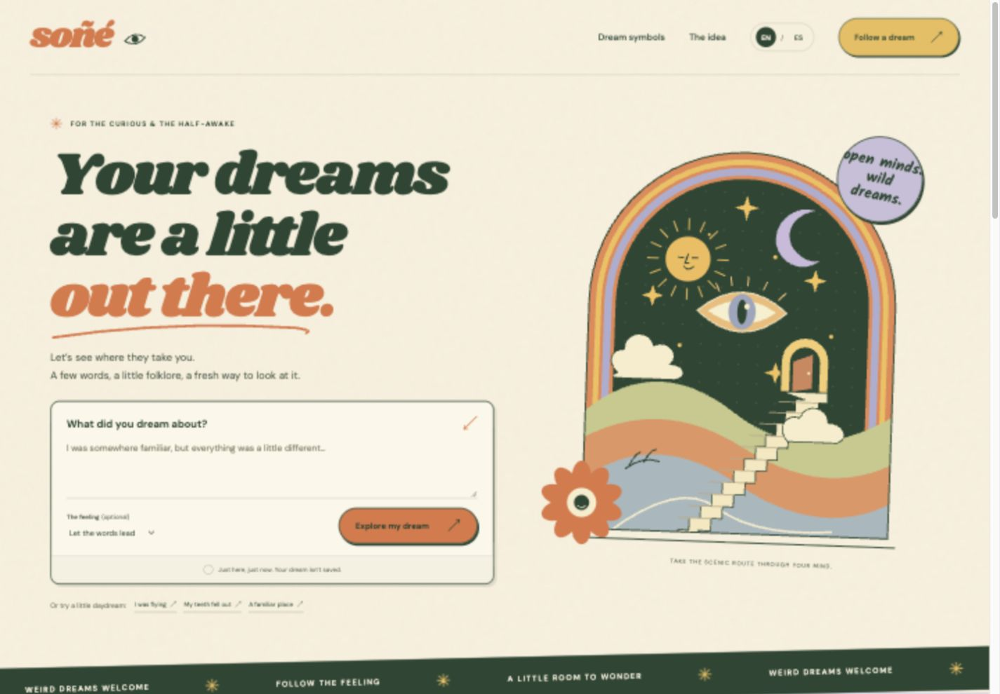

# Soñé

### A little room for your dreams.

A free, bilingual place to explore the strange things you dream about. Describe what you remember, follow the symbols, and take a thought with you.

**[Explore in English](https://sone-tau.vercel.app/?lang=en)** · **[Explorar en español](https://sone-tau.vercel.app/?lang=es)**

Built by [Gil Silva](https://github.com/gilxsilva).



## The experience

**Describe a dream → explore a reading → copy it to share.**

- **English and Spanish.** Switch the whole experience, including readings, examples, cards, and share text. Your draft stays put when you change language.
- **32 illustrated symbols.** Browse by category or search in either language, with accent-insensitive matching.
- **A feeling-first reading.** Add an optional emotion, or let the words guide a lightweight symbolic interpretation.
- **Two ways to look at a symbol.** Reflective questions and folk stories appear separately, with links for further reading on researched additions.
- **Copy, then share.** Preview the text and copy it wherever you like. The original dream is excluded unless you choose to include it.
- **No sign-up. No dream saving.** Nothing to install, no subscription, no interpretation API.

The visual direction brings together bold San Francisco poster lettering, warm colors, original SVG illustration, and the handmade feel of neighborhood murals.

## Run locally

Requires Node.js 20.19+ and npm.

```sh
git clone https://github.com/gilxsilva/sone.git
cd sone
npm ci
npm run dev
```

Open the local URL printed in the terminal, usually `http://127.0.0.1:5173`.

| Command                | Purpose                                             |
| ---------------------- | --------------------------------------------------- |
| `npm run dev`          | Start the local development server                  |
| `npm test`             | Check bilingual content and interpretation behavior |
| `npm run build`        | Type-check and build the static site into `dist/`   |
| `npm run check`        | Run tests and the production build                  |
| `npm run format`       | Format the source and documentation                 |
| `npm run format:check` | Check formatting without changing files             |

No environment variables or API keys are required. You can also open `?lang=es` or `?lang=en` to start in a particular language.

## How it works

The interpreter matches complete English and Spanish words against a small editorial collection. Matches follow the order in the dream. A reading combines the matching themes with a feeling the visitor selects or a simple tone match. It runs entirely in the browser.

This is deliberately lightweight: it does not call a generative model or claim to understand every dream. When nothing matches, it says so and offers a reflective question.

### Privacy

Dreams and readings live only in the current page's memory and clear on reload. The app does not send dream text to a server or persist it in browser storage. Only the language preference is stored locally. Copying a reading writes it to the device clipboard; the visitor chooses where to paste it. Fonts load from Google Fonts, and hosting serves the site's assets.

### Content and its limits

Dream meanings are possibilities, not established facts. Folk stories are cultural material, not predictions. The questions are editorial prompts, not psychological diagnoses. Keep what connects and leave the rest.

See [sources and editorial approach](docs/sources.md) for the collection's references and attribution notes.

## Project structure

```text
src/
  main.tsx          Views, interactions, and original SVG illustrations
  dictionary.ts     Symbols, keyword matching, readings, and sharing
  symbols-es.ts     Spanish symbol descriptions and questions
  i18n.tsx          Language state and preference
  translations.ts   Spanish interface copy
  style.css         Responsive visual design
scripts/
  check.mjs         Focused content and interpretation checks
docs/
  sources.md        References and editorial notes
public/
  favicon.svg       Original site icon
```

## Stack

React 19 · TypeScript · Tailwind CSS 4 · Motion · Vite.

Keyboard-accessible dialogs and perspective tabs, reduced-motion support, and responsive layouts are included. All visual illustrations are original SVG; the typefaces are Shrikhand, DM Sans, and Kalam.

## Deploy on Vercel

Import this repository into Vercel. The checked-in configuration uses the Vite preset, `npm run build`, and the `dist` output directory. No backend, database, or secrets are needed.

## Commit style

Use a parenthesized type and a short description:

```text
(feat) add Spanish dream readings
(fix) preserve the draft when switching languages
(docs) explain the symbol sources
```
